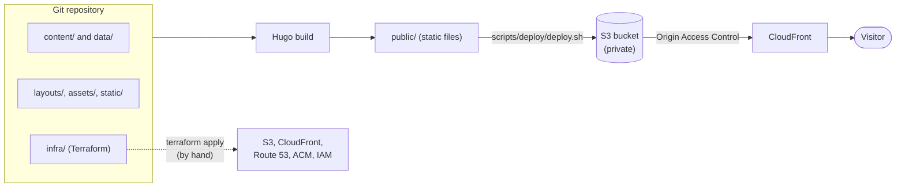
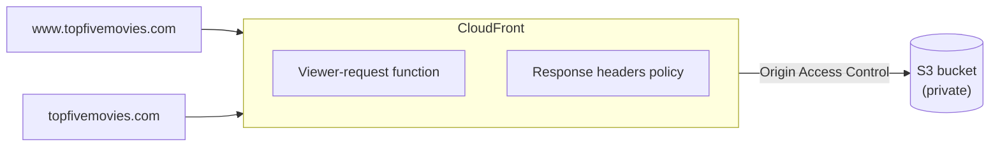
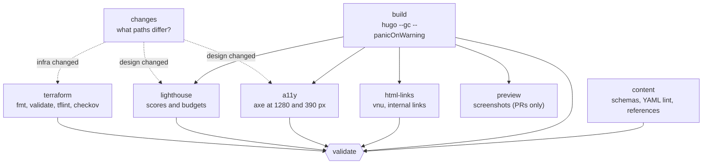

# Architecture and automation

How Top Five Movies is built, hosted and checked. For a short overview see the
[README](README.md). For how to add content, see [CONTRIBUTING.md](CONTRIBUTING.md). This
file goes deeper, and links to the more detailed notes that live next to the code.

- [The big picture](#the-big-picture)
- [Content model](#content-model)
- [The build](#the-build)
- [Hosting](#hosting)
- [Automation](#automation)
- [The life of a change](#the-life-of-a-change)
- [Credentials and trust](#credentials-and-trust)
- [Rollback](#rollback)
- [Where to read more](#where-to-read-more)

## The big picture

There is no server and no database. Content lives in git as Markdown and YAML. A build turns
it into plain HTML files, and those files are copied to a private S3 bucket that CloudFront
serves. Nothing is computed when a visitor loads a page.

Two things are deployed in two different ways, on purpose:

| What | How it ships | Who |
|---|---|---|
| The site (HTML, CSS, images) | Automatically, when a change merges to `main` | The `deploy` workflow |
| The infrastructure | `terraform apply` from `infra/`, after the merge | A person, by hand |

CI can change the site but cannot change the infrastructure.

## Content model

Every item is a file whose **name is its identity**: `content/reviews/the-hurricane.md` is
published as `reviews/the-hurricane.html`. There is no `id` field and no redirect layer.

| Section | Folder | Layout |
|---|---|---|
| Movie reviews | `content/reviews/` | `layouts/movie/` |
| DVD reviews | `content/reviews/` | `layouts/dvd/` |
| Chick flick reviews | `content/chickflicks/` | `layouts/chickflicks/` |
| Top-five lists | `content/top5/` | `layouts/top5/` |
| Other features | `content/other/` | `layouts/other/` |
| Writers | `content/authors/` | `layouts/authors/` |
| Group bio, poll | `content/groupbio.md`, `content/polls.md` | `layouts/groupbio.html`, `layouts/polls.html` |

Each file is YAML front matter (title, date, author, image, and fields specific to the type)
and a Markdown body. Pictures are in `content/images/` and are referenced by name.

Shared data is YAML in `data/`:

- `polls.yaml`: the archived poll and its results. Read-only: there is no voting.
- `quotes.yaml`: film quotes shown on the home page.
- `responses.yaml`: the legacy staff responses to items. Read-only: there is no way to add
  new ones.

Page chrome is built from partials in `layouts/_partials/` (head, navbar, footer, the
previous/next links, recent additions, poll results) and two shortcodes in
`layouts/_shortcodes/`.

## The build

[Hugo](https://gohugo.io) (a single Go binary, no Node) does the whole job. The version is
pinned in `.github/workflows/validate.yml`, `.github/workflows/deploy.yml` and
`.devcontainer/devcontainer.json`. These three must change together.

`hugo --gc --panicOnWarning` is the build in CI. A warning, such as a broken `relref` or a
missing image, fails it. What the build does:

- Renders every page as `<section>/<filename>.html` (`uglyURLs: true` in `hugo.yaml`), with
  the section index as `<section>.html`, plus the RSS feed, sitemap and `robots.txt`.
- Converts Markdown to HTML with Goldmark.
- Joins and minifies the stylesheets, and fingerprints the CSS and JavaScript. Each page
  loads one stylesheet, and its `integrity` attribute is set.
- Resizes images and serves WebP where it is smaller, with the original as the ``
  fallback.
- Writes the result to `public/`, which is not committed.

The site uses no inline scripts or styles, which is what lets the Content-Security-Policy
stay strict.

## Hosting

Terraform in `infra/` describes all of it; [infra/README.md](infra/README.md) has the file
map, the setup steps and the cutover plan.

- **S3.** A private bucket with the public access block on. Only CloudFront can read it, by
  Origin Access Control. No versioning or lifecycle rules, on purpose: git is the history.
- **CloudFront.** One distribution. A CloudFront Function on each viewer request redirects
  the bare domain to `www` (a 301 that keeps the path and query string) and serves
  `index.html` for a path ending in `/`. A response headers policy adds HSTS, a strict
  Content-Security-Policy and the other security headers. A custom 404 page is served for
  missing files.
- **Route 53 and ACM.** The hosted zone, the alias records, and a certificate in `us-east-1`
  validated by DNS. These are created only when `enable_custom_domain` is true, which waits
  for the registrar to delegate to Route 53 (the cutover).
- **IAM.** Two users, with their permissions attached directly: `topfivemovies-deploy`
  (write the bucket, invalidate the cache) and `topfivemovies-plan` (read-only).
- **State.** The Terraform state is in a separate, hand-made S3 bucket, locked with a
  lockfile beside it. There is no DynamoDB table.
- **Cost alert.** An optional monthly budget, off unless `alert_email` is set.

There is one environment. There is no staging site: a pull request gets screenshots of the
pages it changes, and a codespace is for trying a change.

## Automation

Six GitHub Actions workflows live in `.github/workflows/`. The scripts they call are in
`scripts/` so the same checks run locally.

| Workflow | Runs on | Purpose | Blocks merge? |
|---|---|---|---|
| `new-content` | A branch is created with a known prefix | Adds the starting file | No |
| `validate` | Pull requests and pushes to `main` | Validates, builds and checks the site | **Yes**: the `validate` job |
| `spelling` | Pull requests touching `content/` or `data/` | Spelling review | No |
| `grammar-review` | Pull requests touching `content/` or `data/` | Grammar review | No |
| `terraform-plan` | Pull requests touching `infra/` | Comments the plan | No |
| `deploy` | Push to `main`, or run by hand | Publishes the site | Not applicable |

### new-content

Creating a branch named `review/<title>`, `dvd/<title>`, `chickflick/<title>`,
`top5/<title>`, `other/<title>` or `author/<name>` starts this workflow. It runs
`scripts/new-content/new_content.py`, which picks the template from
`scripts/new-content/templates/`, fills in the title and today's date, and commits the starting
file to the branch. If the branch name cannot be used, it opens an issue that says why. The
contributor then edits the file in the GitHub UI and opens the pull request themselves.

The workflow does not open the pull request, because a commit or pull request made with the
default token does not trigger other workflows, so `validate` would never run. GitHub also
runs `create` workflows from the default branch, so a change to this workflow takes effect
only after it is merged.

### validate

This is the required check. Branch protection names only `validate`, and every job feeds it
(`scripts/github/branch-protection.sh` sets this up).

| Job | What it checks |
|---|---|
| `content` | `scripts/content/validate.sh`: yamllint, a JSON Schema per content type (`scripts/content/schemas/`) applied to each file's front matter, and `check_refs.py` for what a schema cannot see: lowercase slug filenames, every `author` and response `item` names a real page, every `relref` resolves, every image reference resolves and no image in `content/images/` is unused |
| `build` | The Hugo build. Its `public/` output is passed to the jobs below as an artifact |
| `html-links` | The Nu HTML Checker on every page, stylesheet and SVG (any error or warning fails), and lychee for internal links and `#fragments` |
| `a11y` | axe-core in headless Chrome on every page at desktop and phone width: WCAG 2.0 and 2.1 A and AA, and at phone width 2.2 AA as well |
| `lighthouse` | Lighthouse CI on seven representative pages: performance, accessibility, SEO and best-practice scores, Core Web Vitals limits, and per-page size budgets with no third-party requests |
| `terraform` | `terraform fmt -check`, `validate` (without the backend, so no AWS access), tflint and checkov |
| `preview` | Not part of `validate`. Screenshots the pages a pull request changes (see below) |
| `validate` | Passes if no job failed or was cancelled |

`a11y` and `lighthouse` run only when the design or the checks change (`DESIGN_PATHS`:
`assets`, `layouts`, `static`, `hugo.yaml`, `scripts/quality`, the workflow itself), and
`terraform` runs only when `infra/` changes. A `changes` job diffs against the base to decide.
These are skipped jobs rather than a path filter on the workflow, so `validate` still reports
a status that a required check can rely on. A skipped job counts as a pass.

**Preview.** `scripts/preview/preview.py` works out which pages a pull request affects from
the diff (a changed `.md` file, the pages that use a changed image, the item pages whose
responses changed, the poll page, or the home page for quotes) and takes full-page PNGs at
1280 px and 390 px. They are uploaded as an artifact kept 14 days, and a link and table are
commented on the pull request. The comment is edited on each push rather than repeated
(`scripts/github/pr_comment.py`). At most 20 pages are shot. Template and style changes are
not content, so they get no preview; the quality gates cover them.

### spelling and grammar-review

Two advisory checks on the writing. Both look **only at the lines a pull request adds or
changes**, because the legacy content was migrated as it was and a fix to one sentence should
not have to clear every old error in the file.

- **spelling** runs [typos](https://github.com/crate-ci/typos). It flags known misspellings,
  so film titles and names rarely trip it. Names and slang go in `_typos.toml`.
- **grammar-review** runs LanguageTool and Harper for the errors a spell checker cannot see,
  such as to/too/two and its/it's. Which rules count is in `scripts/prose/rules.json`: style
  and tone rules are off, because the voice is informal on purpose.

Findings are posted as one comment-only pull request review, with a suggestion block where
the fix is one unambiguous replacement, so the author can apply it with a click. Neither
fails a job. On a fork the token is read-only, so there the findings are warning annotations
on the changed lines. Details: [scripts/prose/README.md](scripts/prose/README.md).

### terraform-plan

When a pull request touches `infra/`, this runs `terraform plan` as the read-only
`topfivemovies-plan` user, with `-lock=false` so it never writes the state, and comments the
plan on the pull request. It applies nothing. Without the `AWS_PLAN_*` secrets (not set yet,
or a fork) the job does nothing.

### deploy

Runs when a change lands on `main`, in the `Production AWS` environment, which only `main`
can use. One deploy runs at a time, and one is never cancelled halfway.

1. Check that the credentials and `DISTRIBUTION_ID` are set.
2. Check out the commit and run `hugo --gc --panicOnWarning`.
3. Decide how much of the cache to invalidate: everything if the design paths changed, if
   there is no usable previous commit, or if the run is a manual one. Otherwise only the
   changed files.
4. `scripts/deploy/deploy.sh`:
   - Compare each file's MD5 with the ETag of the object in S3, and upload only what changed.
   - Upload fingerprinted files first and the rest after, so a page never names an asset that
     is not there yet.
   - Delete what the build no longer has, after the uploads, so a linked page is never missing.
   - Set `Cache-Control` by kind: a year and `immutable` for fingerprinted files; five
     minutes for HTML, feeds and the sitemap; a day for anything else.
   - Invalidate the changed paths, or `/*` for a design change or more than 500 paths, and
     wait for the invalidation to finish.
5. `scripts/deploy/smoke.sh` tests the live address: the home page, one page of each
   section, the feed, the sitemap, `robots.txt`, a real 404, the fingerprinted CSS and
   JavaScript the home page names, and the security headers.

The deploy workflow rebuilds from source instead of reusing the `validate` artifact, so what
ships is always exactly the merged commit.

## The life of a change

**A new review.** A contributor creates `review/popeyes-revenge` in the GitHub UI.
`new-content` commits a starting file. They edit it and open a pull request. `validate` checks
the schema, references, build, HTML, links and (if the design is untouched) skips the slow
quality jobs. `preview` comments screenshots; `spelling` and `grammar-review` comment
suggestions. A reviewer approves and merges. `deploy` builds, syncs, invalidates the one page
and the home page, and smoke-tests the live site.

**A template or style change.** The same, except `a11y` and `lighthouse` also run, there is
no preview, and the deploy invalidates the whole cache.

**An infrastructure change.** A pull request that touches `infra/` runs the `terraform` job
and `terraform-plan` comments the plan. After the merge, a person runs `terraform plan` and
`terraform apply` from `infra/`. The `deploy` workflow also runs when `infra/` changes
but has nothing to publish.

## Credentials and trust

The account does not support OIDC, so CI uses long-lived IAM access keys. The design limits
what a leaked key can do:

| Credential | Held as | Readable by | Can do |
|---|---|---|---|
| `topfivemovies-plan` key | Repository secrets `AWS_PLAN_*` | Any workflow run, including a pull request's | Read configuration, no object data. Cannot change anything |
| `topfivemovies-deploy` key | Secrets in the `Production AWS` environment | Only a run on `main` that declares the environment | Write the site bucket and invalidate the cache. Cannot change infrastructure |
| Operator keys | The person's own, in a codespace or devcontainer | The person | Everything in `infra/terraform-operator-policy.json` |

Terraform creates the two CI users but not their keys, because a key created by Terraform
would have its secret in the state file. They are created by hand and passed straight to
`gh secret set`, so the secret never touches disk. Rotation steps are in
[infra/README.md](infra/README.md).

Other guards:

- The default workflow token is `contents: read`. Each workflow adds only what it needs
  (`pull-requests: write` to comment, `contents: write` for `new-content`).
- Branch names in `new-content` are untrusted input and are only used through environment
  variables, never in a shell command.
- Third-party tools downloaded by scripts (`vnu`, `axe-core`, `lychee`, LanguageTool, Harper)
  are pinned and checked against a published checksum.
- A fork's pull request gets no secrets, so `terraform-plan` does nothing there and the prose
  checks fall back to annotations.
- `CODEOWNERS` makes the repository owner the default reviewer.

## Rollback

A rollback is a redeploy of an earlier commit. In GitHub, go to Actions, then `deploy`, then
Run workflow, and give the commit, tag or branch as `ref`. The workflow file is always the
one on `main`, and the build is of `ref`. A manual run invalidates the whole cache, because
the older commit can differ from what is live in any way.

For the domain, the cutover can be rolled back by setting the registrar's name servers back
(see [infra/README.md](infra/README.md)).

## Where to read more

| Topic | File |
|---|---|
| Adding content | [CONTRIBUTING.md](CONTRIBUTING.md) |
| Goals, decisions and phases | [ROADMAP.md](ROADMAP.md) |
| Terraform, state, applying, secrets, the cutover | [infra/README.md](infra/README.md) |
| Design, CSS and the quality gates | [scripts/quality/README.md](scripts/quality/README.md) |
| Spelling and grammar checks | [scripts/prose/README.md](scripts/prose/README.md) |
| Pull request previews | [scripts/preview/README.md](scripts/preview/README.md) |
