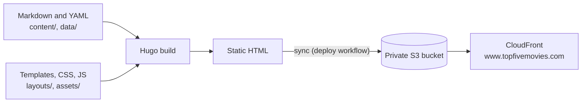

# Top Five Movies

Movie reviews, DVD reviews, chick flick reviews, top-five lists and more, at
**[www.topfivemovies.com](https://www.topfivemovies.com)**.

Want to add a review or a list? See the [contributing guide](CONTRIBUTING.md). You can do it
all in your browser on GitHub.

## How the site works

The site is static. Nothing runs when someone visits a page: every page is rendered ahead of
time and served as a plain HTML file.

1. **Write.** Every review and list is a Markdown file with YAML front matter in `content/`.
   Shared data such as polls and quotes is YAML in `data/`. The filename is the item's identity
   and becomes its address.
2. **Build.** [Hugo](https://gohugo.io) combines the content with the templates in `layouts/`
   and renders the whole site to HTML.
3. **Publish.** When a change is merged to `main`, the deploy workflow builds the site, syncs it
   to a private S3 bucket and invalidates the CloudFront cache. A smoke test then checks the
   live site.
4. **Serve.** CloudFront is the only thing that can read the bucket. It adds security headers
   and redirects `topfivemovies.com` to `www`.

Pull requests get the same build as a preview with screenshots of the changed pages, plus
spelling and grammar checks. The infrastructure (S3, CloudFront, Route 53, ACM, IAM) is
Terraform in `infra/`; see [infra/README.md](infra/README.md). The reasoning behind the
design is in [ROADMAP.md](ROADMAP.md).

For the detail on the build, hosting, each workflow, credentials and rollback, read
[ARCHITECTURE.md](ARCHITECTURE.md).

## Repository layout

| Path | What |
|---|---|
| `content/` | The site's words: `reviews/`, `chickflicks/`, `top5/`, `other/`, `authors/`, plus the group bio and poll pages |
| `data/` | Shared YAML data: `polls.yaml`, `quotes.yaml`, `responses.yaml` |
| `layouts/` | Hugo templates, one folder per content type, plus `_partials/` and `_shortcodes/` |
| `assets/` | CSS, JavaScript and images that Hugo processes and fingerprints |
| `static/` | Files copied to the site unchanged (the favicon) |
| `hugo.yaml` | Site configuration |
| `infra/` | Terraform for S3, CloudFront, DNS, certificates and the CI users |
| `scripts/` | Tooling used by CI and contributors: `content/` (front matter and reference checks), `new-content/` (starter files for new branches, and the author list in their templates), `preview/`, `prose/` (spelling and grammar), `quality/` (accessibility and Lighthouse), `deploy/`, `github/` |
| `.github/` | Workflows (`validate`, `deploy`, `terraform-plan`, `new-content`, `author-list`, `spelling`, `grammar-review`) and `CODEOWNERS` |
| `.devcontainer/` | Codespace and devcontainer setup, with the pinned Hugo version |
| `CONTRIBUTING.md` | How to add content |
| `ROADMAP.md` | Goals and decisions behind the modernization |
